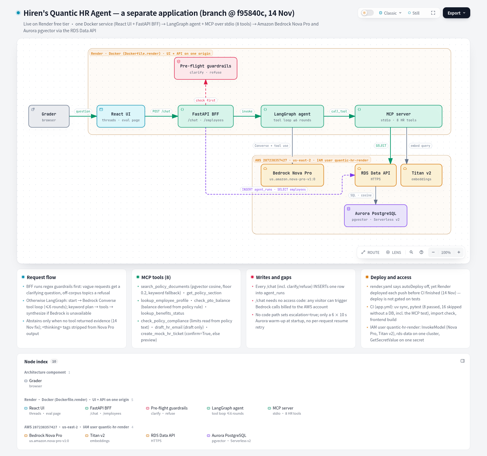
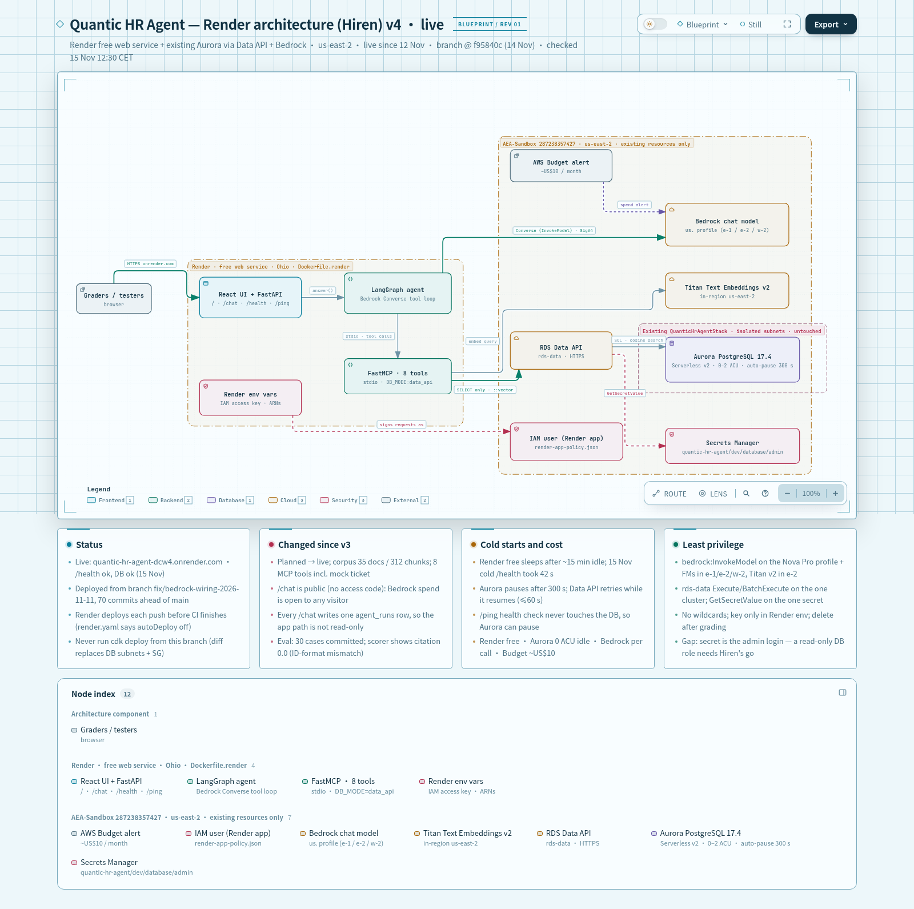

# Quantic HR Agent

Agentic RAG + MCP project for Quantic AI Engineering Techniques and Architectures. **Submission: November 15, 2026.**

**Live application:** https://quantic-hr-agent-dcw4.onrender.com/
**Health:** https://quantic-hr-agent-dcw4.onrender.com/health
**This repository:** https://github.com/vadaliah/Quantic_HR_Agent

**Companion group repository (Apex People AI):** https://github.com/meghnadesaii/apex-people-ai — live at https://apex-people-ai.onrender.com/. Apex is the shared group repo for the same assignment brief, on a different stack.

**Architecture views:** [current architecture](docs/architecture/hiren-quantic-hr-agent.architecture-2026-11-15.html), [live/target architecture v4](docs/architecture/hiren-target-architecture-2026-11-15-v4.html), and [comparison with Apex People AI](presentation/apex-vs-hiren.architecture-2026-11-15.html). PNG previews and a short index are in [docs/architecture/README.md](docs/architecture/README.md) and [presentation/README.md](presentation/README.md).

Clone the default branch, `main`. It is the source of truth for this repository. The live URL is listed above.

**Cold starts:** Render Free can sleep after inactivity, and Aurora Serverless v2 can auto-pause. A public `GET /health` on 15 Nov 2026 at 15:11 CET (Europe/Berlin) took 42.4 seconds (consistent with a cold start). That is a health-check time, not chat latency. Warm `/health` and `/chat` times are documented in `design-and-evaluation.md` and `deployed.md`. This documentation update did not call live `/chat`.


## Presentation views

Interactive Archify diagrams for this submission (15 November 2026):

- [Current Quantic HR Agent architecture](docs/architecture/hiren-quantic-hr-agent.architecture-2026-11-15.html) — [PNG preview](docs/architecture/hiren-quantic-hr-agent-2026-11-15-full.png)
- [Live / target architecture (v4)](docs/architecture/hiren-target-architecture-2026-11-15-v4.html) — [PNG preview](docs/architecture/hiren-target-architecture-2026-11-15-v4.png)
- [Comparison with Apex People AI](presentation/apex-vs-hiren.architecture-2026-11-15.html) — [PNG preview](presentation/apex-vs-hiren-2026-11-15-full.png)

See [docs/architecture/README.md](docs/architecture/README.md) and [presentation/README.md](presentation/README.md). These views contain no access codes, keys, or tokens.

## Where the data lives

**Deployment = Render + the existing Aurora database.** The app runs as one Render free web
service (`render.yaml`, `Dockerfile.render`) and reads Hiren's existing Aurora Serverless v2
PostgreSQL cluster (`QuanticHrAgentStack`, database `quantic_hr_agent`) through the RDS Data
API (`DB_MODE=data_api`, read-only). Bedrock provides chat and embeddings. See
[docs/DEPLOY_RENDER.md](docs/DEPLOY_RENDER.md). Local development and tests use a local
Postgres with the same migrations (`DB_MODE=psycopg`, the default).

| Piece | Where it runs |
| --- | --- |
| React UI (Vite) | Local (port 5173), or built into the Render service and served at `/` |
| FastAPI BFF + LangGraph + MCP | Local process, or the Render free web service (`$PORT`) |
| Database access | `DB_MODE=psycopg` locally, `DB_MODE=data_api` (Aurora Data API) on Render |
| Postgres + pgvector | Aurora Serverless v2, `us-east-2`, database `quantic_hr_agent` |
| Embeddings + chat | Amazon Bedrock: Titan Text Embeddings v2 (1024 dims) and one chat model, default Amazon Nova Pro (`us.amazon.nova-pro-v1:0`) |

```text
Vite (5173) → FastAPI /chat /health → LangGraph → Bedrock Converse tool-use loop
                                                  ↘ stdio MCP tools → Aurora + pgvector
```

The agent runs a Bedrock Converse tool-use loop over the MCP tools and answers only from
tool results, citing `[document_id section_id]`. If no tool result grounds the answer it
abstains and points to People Operations. When Bedrock is unavailable (no AWS credentials,
an error, or `QUANTIC_AGENT_MODE=keyword`) it falls back to the local keyword router, which
uses the same MCP tools. Policy search uses pgvector cosine similarity over Titan v2
embeddings and falls back to `ILIKE` when no embeddings are loaded.

### Architecture diagrams

Interactive Archify views of this deploy-branch revision (`f95840c`, 14 Nov 2026) live in [`docs/architecture/`](docs/architecture/). Open the HTML in a browser; the PNG is a static snapshot. The files contain no credentials or private-network details. They do repeat AWS identifiers already present in this repository (account id, IAM user name, Secrets Manager secret name).

**Current architecture** (15 Nov 2026) — [interactive HTML](docs/architecture/hiren-quantic-hr-agent.architecture-2026-11-15.html)



**Target architecture v4** (15 Nov 2026, updated to the live Render + Aurora deployment) — [interactive HTML](docs/architecture/hiren-target-architecture-2026-11-15-v4.html)



## Configuration

One chat model is used at a time. `BEDROCK_CHAT_INFERENCE_PROFILE` (app) and the CDK context
`quanticChatModel` (runtime role) must name the same model:

| Model | App setting | CDK context | Status in us-east-2 (checked 2026-11-11) |
| --- | --- | --- | --- |
| Amazon Nova Pro (default) | `us.amazon.nova-pro-v1:0` | `nova-pro` | Active via `us.` profile only; access in 287238357427 **not yet confirmed** |
| Claude Sonnet 4.6 (alternative) | `us.anthropic.claude-sonnet-4-6` | `claude-sonnet-4-6` | Active via `us.` profile; Claude access recorded in `docs/STEP0_AWS_FINDINGS.md` |

> **Before deploy:** confirm Nova Pro model access is enabled in account `287238357427`
> (us-east-2). `docs/STEP0_AWS_FINDINGS.md` records only Titan and Claude. If it is not
> enabled, enable it or switch both settings to Claude Sonnet 4.6.

Claude Sonnet 4.5 is marked Legacy in Bedrock and is no longer configured.

| Variable | Default | Purpose |
| --- | --- | --- |
| `BEDROCK_CHAT_INFERENCE_PROFILE` | `us.amazon.nova-pro-v1:0` | Chat model (see above) |
| `BEDROCK_EMBEDDING_MODEL` | `amazon.titan-embed-text-v2:0` | Embeddings, 1024 dims, normalized |
| `AWS_REGION` | `us-east-2` | Bedrock region |
| `QUANTIC_AGENT_MODE` | `auto` | `auto` (Bedrock when AWS credentials exist), `bedrock`, `keyword` |
| `QUANTIC_RETRIEVAL` | `auto` | `auto` (vector when embeddings and credentials exist), `vector`, `keyword` |
| `QUANTIC_MIN_SIMILARITY` | `0.2` | Cosine floor for policy matches; lower matches are dropped so the agent abstains. Tune after ingestion. |
| `QUANTIC_AS_OF` | today | Fixed date for PTO balances (evaluation and tests pin `2026-11-03`) |

## Database setup

The database is named `quantic_hr_agent` everywhere: the CDK cluster default database,
the Data API migration runner, migration 003's grant, the scripts and `.env.example`.

Migrations and seeds run through the guarded RDS Data API runner. It opens its own
transaction, uses the admin secret, verifies the account, region and cluster before doing
anything, and prompts for a typed confirmation.

```bash
# 1. Parse-check offline first (no AWS call)
bash infrastructure/database/scripts/run-sql.sh --check infrastructure/database/migrations/004_hr_schema_v2.sql

# 2. Apply migrations in order
QUANTIC_ALLOW_SQL_MIGRATIONS=yes bash infrastructure/database/scripts/run-sql.sh infrastructure/database/migrations/004_hr_schema_v2.sql
QUANTIC_ALLOW_SQL_MIGRATIONS=yes bash infrastructure/database/scripts/run-sql.sh infrastructure/database/migrations/005_tighten_runtime_grants.sql

# 3. Seed synthetic HR data (25 employees, PTO accrual, benefits)
python infrastructure/database/scripts/seed.py > /tmp/quantic_seed.sql
bash infrastructure/database/scripts/run-sql.sh --check /tmp/quantic_seed.sql
QUANTIC_ALLOW_SQL_MIGRATIONS=yes bash infrastructure/database/scripts/run-sql.sh /tmp/quantic_seed.sql
```

Order matters: `005` revokes the runtime role's write access, so seeding and corpus ingestion
always use the admin secret.

## Corpus ingestion (RAG)

`corpus/` holds 35 policy files: 30 base policies (`POL-001` … `POL-030`) and 5 annexes
(`POL-001A`, `POL-002A`, `POL-005A`, `POL-006A`, `POL-009A`). That is 20,077 words, or
roughly 40–67 pages at 500–300 words per page. `POL-006` and `POL-011` live under
`corpus/sources/` and are still discovered by `scripts/ingest_corpus.py` (`rglob("POL-*")`).
`corpus/SOURCES.md` is provenance, not a policy, and is not ingested.
Until ingestion has run, `policy_chunks` is empty and policy questions return
"no matching passage" — that is the correct answer against an empty index, not a bug.

```bash
export DATABASE_URL=postgresql://quantic_hr_admin:<pw>@<cluster-endpoint>:5432/quantic_hr_agent
uv run python scripts/ingest_corpus.py --dry-run          # parse + chunk only, no AWS, no writes
uv run python scripts/ingest_corpus.py                    # embed with Titan v2 and write policy_chunks
uv run python scripts/ingest_corpus.py --skip-embeddings  # text only (keyword search), no AWS
```

`--dry-run` (15 Nov 2026, no AWS and no database write) reports 35 documents and 312 chunks
(one per numbered section, with a split only when a section exceeds the size bound) and an
estimate of about 29,900 tokens. Chunk IDs are
`<document>:<section>` (for example `POL-001:2.1`), so re-running updates rows in place;
unchanged text keeps its embedding (`content_sha`), sections removed from a document are
deleted, and `--force` re-embeds everything.

Ingestion needs a direct Postgres connection because the embeddings must be computed by
Bedrock before the SQL is written, which the Data API cannot do on its own.

## Running the app

The application needs `DATABASE_URL` and AWS credentials for Bedrock.

```bash
uv sync --group dev
export DATABASE_URL=postgresql://quantic_hr_agent@<cluster-endpoint>:5432/quantic_hr_agent
export AWS_REGION=us-east-2
uv run uvicorn quantic_hr.bff:app --app-dir src --port 8000

# in another shell
npm --prefix frontend install
npm --prefix frontend run dev
```

## Tests

```bash
uv run pytest -q
```

The suite under `tests/` has 37 tests. No test calls AWS: Bedrock is replaced by a fake client (`tests/fakes.py`). A local offline run on this branch (15 Nov 2026, no database) reported **21 passed, 16 skipped**.

**Why some tests are skipped.** Fixtures in `tests/conftest.py` skip (they do not fail) when a seeded local Postgres is unreachable, so the GitHub Actions `app` workflow can still run the offline suite.

- Always run (no database): `tests/test_bedrock.py` (6), `tests/test_ping.py` (1), `test_mode_selection` in `tests/test_agent_converse.py` (1), `tests/test_eval_scoring.py` (12), and `test_mcp_lists_eight_tools_without_database` in `tests/test_mcp.py` (1).
- Skipped in CI and on any machine without `DATABASE_URL` pointing at a reachable, seeded Postgres (migrations 001–006 and seed applied; default URL `postgresql://quantic@127.0.0.1:5433/quantic_hr_agent`): the remaining tests in `test_agent_converse.py`, all of `test_agent_and_bff.py`, the two database-backed tests in `test_mcp.py` (a live tool call and a policy-search call), and all of `test_retrieval.py`. The policy-search tests also require `policy_chunks` to be loaded. `test_mcp_lists_eight_tools_without_database` does not need a database and runs in CI.

**How to run the skipped tests locally** (does not touch the deployed Aurora database):

```bash
# Start a local Postgres with pgvector, apply migrations 001–006, load the seed
# (see Database setup above), then optionally ingest text without Bedrock:
uv run python scripts/ingest_corpus.py --skip-embeddings
export DATABASE_URL=postgresql://quantic@127.0.0.1:5433/quantic_hr_agent
uv run pytest -q
```

To run only the offline suite, leave `DATABASE_URL` unset or pointing at an unreachable host; pytest will skip the database-backed tests and still run the others, including the database-free MCP `list_tools` check. `tests/test_mcp.py` asserts all eight tool names (`search_policy_documents`, `get_policy_section`, `lookup_employee_profile`, `check_pto_balance`, `check_policy_compliance`, `draft_hr_email`, `lookup_benefits_status`, and `create_mock_hr_ticket`).

## Demo workflows

Seed employees are `E1001`–`E1025` (`mock_data/employees.json`); the UI offers E1007, E1012,
E1019 and E1001.

1. **Remote work from abroad** — `E1007` asks about working from Portugal for six weeks.
   Over 30 consecutive days triggers People Operations and Legal approval (POL-004 2.2), with
   security conditions from POL-006 3.3 and the approval path from POL-003 4.3.
2. **PTO request** — `E1012` asks about three days next week. The balance covers it
   (POL-001 2.1), three days or more needs manager approval (POL-001 3.1), and five business
   days' notice applies. `E1019` is the insufficient-balance path.

## AWS CDK (record of the existing database stack only)

```bash
cd infrastructure
npm ci && npm test && npm run synth && npm run synth:reuse
```

**Do not run `cdk deploy` from this branch.** `QuanticHrAgentStack` is already deployed in
account `287238357427`, `us-east-2` (created 2026-11-03; Aurora database `quantic_hr_agent`
holds live data, deletion protection on, pre-update snapshot
`quantic-hr-agent-pre-update-20261111-2326`). The read-only `cdk diff` of 2026-11-11
([docs/evidence/cdk-diff-2026-11-11.txt](docs/evidence/cdk-diff-2026-11-11.txt)) shows this
code would replace the DB subnets and security group. The CDK app is kept only as a record of
the database stack. The AgentCore pieces (`Dockerfile`, `/invocations`, the
`AgentContainerRuntime` construct) are not used. Do not run `scripts/deploy-sandbox.sh`.
Café Fausse and AEA stay untouched.

## Deployment and teardown

Hosting is Render; follow [docs/DEPLOY_RENDER.md](docs/DEPLOY_RENDER.md).

**Status (2026-11-12 ~00:58 CET, Europe/Berlin): live at https://quantic-hr-agent-dcw4.onrender.com/.** The IAM user `quantic-hr-render` with the
least-privilege policy and its access key exist. Live smoke (same time): `/ping` 200 `{"status":"Healthy"}`;
`/health` 200, `runtime=render`, `database.ok` true, `mode=data_api`, Nova Pro and Titan v2; `POST /chat`
for E1007 "How many PTO days do I have left?" returned "10.9 PTO days left as of 2026-11-11 [POL-001 2.1]" via
`check_pto_balance` in about 11 s; the remote-work question answered `mode=bedrock` with POL-003
citations in about 14 s. Still to do: the AWS Budget alert. Do not run `cdk deploy`.

- **AWS side:** an IAM user with `infrastructure/iam/render-app-policy.json` (Bedrock
  `InvokeModel` on Nova Pro and Titan v2, Data API on the one cluster, `GetSecretValue` on the
  one secret) and an AWS Budget alert of about $10. Humans create both; nothing else changes
  in AWS.
- **Cost:** Render free tier; Aurora stays at 0 ACU when idle (auto-pause after 300 s);
  Bedrock is pay per request.
- **Model access.** Nova Pro (the default) is confirmed in account `287238357427` (Converse
  smoke call, 2026-11-12); `CHAT_MODEL=us.anthropic.claude-sonnet-4-6` is the alternative.
- **Teardown after grading:** delete the IAM access key (or user) and suspend or delete the
  Render service. The Aurora cluster is Hiren's and stays as is.

## Docs
- [Architecture views](docs/architecture/)
- [Deploy on Render](docs/DEPLOY_RENDER.md)
- [Cost-first strategy](docs/COST_FIRST_DELIVERY_STRATEGY.md)
- [Master plan](docs/MASTER_PLAN.md)
- [design-and-evaluation.md](design-and-evaluation.md)
- [ai-tooling.md](ai-tooling.md)
- [deployed.md](deployed.md)
- [Architecture presentation views](presentation/README.md)
