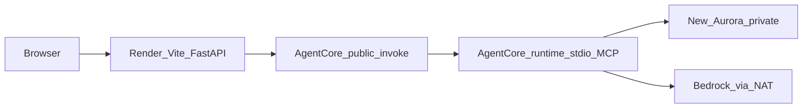

# Step 0 read-only findings

Write [docs/STEP0_AWS_FINDINGS.md](docs/STEP0_AWS_FINDINGS.md) from the checks below, then stop. This is not approval to provision. Café Fausse and AEA resources stay untouched.

## What was verified

Caller `AEA-Sandbox-PowerUser` in account `287238357427`, region `us-east-2` (the account already hardcoded in Café Fausse scripts). Local checkout [`/Users/hirenvadalia/cafe-fausse-application`](/Users/hirenvadalia/cafe-fausse-application) is `vadaliah/Quantic_Cafe_Fausse_Application` at `dc9f514` on `main`. No secrets were read and no model was invoked.

Live stacks in `us-east-2`:

- `CafeFausseApplicationStack` — `CREATE_COMPLETE` (2026-09-02). Aurora PostgreSQL 17.4 Serverless v2, 0.5–2 ACU, IAM auth, encrypted, database `cafe_fausse_db`, **stopped**, private. Secret name `cafe-fausse-application/database/admin` (value not read).
- `AeaSandboxStack` — `UPDATE_COMPLETE`. Same Aurora shape, database `aea`, **stopped**. Secret `aea/sandbox/database/admin`.
- `CDKToolkit` — bootstrap version 32, already present for this account and region.

There is no Quantic stack. Café Fausse is a non-agentic Flask and Vite app with a private Aurora database. No Bedrock model resource, AgentCore runtime, or MCP server belongs in that stack, and none was found. That absence is expected.

Both non-default VPCs (`10.0.0.0/16`) are isolated-only: route tables are local-only, NAT count is 0, and only the default VPC has an internet gateway. That network matches Café Fausse's database-only workload. It is not a Quantic agent network. Café subnets are `use2-az1` and `use2-az2`, which are AgentCore-supported AZs, but Quantic still needs its own VPC.

CloudFormation still lists three Café SSM interface endpoints as `CREATE_COMPLETE`, and EC2 reports those endpoint IDs as not found. A region-wide endpoint list is empty. Both SSM access hosts (`t4g.nano`) are stopped. The Café admin tunnel is drifted and was not repaired.

`pgvector` was not queried. Starting either stopped cluster would change AWS state, so extension install stays unverified. `rds.allowed_extensions` is unset on `default.aurora-postgresql17`, which does not show a block, and engine 17.4 is available in-region.

Bedrock was checked at the account and region, not inside the Café Fausse stack. In `us-east-2`, entitlement and authorization are `AVAILABLE` / `AUTHORIZED`. No `InvokeModel` call was made:

- `amazon.titan-embed-text-v2:0`
- Claude Sonnet 4.5, Haiku 4.5, and Sonnet 4.6 (agreement field `NOT_AVAILABLE`; authorization is still `AUTHORIZED`)
- Active inference profile `us.anthropic.claude-sonnet-4-5-20250929-v1:0` includes `us-east-2`

`bedrock-agentcore-control list-agent-runtimes` succeeds in `us-east-2` and returns no runtimes. An empty list means Quantic has not deployed an agent yet. The control-plane call itself shows the API is available in this region.

No Render blueprint or GitHub Actions workflow exists in this repo, the Café Fausse checkout, or `code/quantic`. `docs/deployment` in Café Fausse is empty. `gh` could not search other GitHub repos because the `vadaliah` token is invalid. [`/Users/hirenvadalia/code/survey-splashpad/render.yaml`](/Users/hirenvadalia/code/survey-splashpad/render.yaml) is a different application.

## Connectivity decision

Do not attach Quantic to the Café Fausse VPC. That VPC is the right shape for Café's database and SSM admin host, and it has no Bedrock path because Café never needed one. Quantic's new agent path needs private subnets that can reach Aurora and Bedrock. The Café SSM port-forward stays an admin path only, and it is not the agent's database connection.

Proposed Quantic path, after approval:

- New stack `QuanticHrAgentStack` in the same account and `us-east-2`, new VPC, new cluster, new secret `quantic-hr-agent/dev/database/admin`, database `quantic_hr`. Same account is acceptable only because every configured profile points here; isolation is by stack, VPC, security group, and secret name.
- One NAT gateway and private subnets in `use2-az1` and `use2-az2`. Aurora stays private. AgentCore uses `networkMode=VPC` with a security group that may open TCP 5432 only to the new Aurora security group. Inbound users still call the public AgentCore endpoint.
- MCP server runs over stdio inside that runtime. No AgentCore Gateway and no second MCP host.
- Bedrock chat model: `us.anthropic.claude-sonnet-4-5-20250929-v1:0`. Embeddings: `amazon.titan-embed-text-v2:0`. IAM database auth for the runtime; generated secret only for admin migration.

NAT is about `$33/month` plus data, and Aurora charges only while the new cluster is running. Interface-endpoint-only networking is the fallback if NAT is rejected; it is similar monthly cost and more moving parts. Café and AEA clusters stay stopped.

## Reuse matrix

Reusable patterns, copied into this repo only:

- [`infrastructure/bin/infrastructure.ts`](/Users/hirenvadalia/cafe-fausse-application/infrastructure/bin/infrastructure.ts)
- [`infrastructure/lib/infrastructure-stack.ts`](/Users/hirenvadalia/cafe-fausse-application/infrastructure/lib/infrastructure-stack.ts)
- [`infrastructure/lib/constructs/database.ts`](/Users/hirenvadalia/cafe-fausse-application/infrastructure/lib/constructs/database.ts) for Aurora 17.4, IAM auth, 0.5–2 ACU, encrypted secret
- [`infrastructure/lib/constructs/database-access.ts`](/Users/hirenvadalia/cafe-fausse-application/infrastructure/lib/constructs/database-access.ts)
- [`infrastructure/scripts/validate-aws-env.sh`](/Users/hirenvadalia/cafe-fausse-application/infrastructure/scripts/validate-aws-env.sh), [`synth-infra.sh`](/Users/hirenvadalia/cafe-fausse-application/infrastructure/scripts/synth-infra.sh), [`deploy-sandbox.sh`](/Users/hirenvadalia/cafe-fausse-application/infrastructure/scripts/deploy-sandbox.sh) for the validate, synth, diff, confirm, deploy sequence
- [`frontend/package.json`](/Users/hirenvadalia/cafe-fausse-application/frontend/package.json) Vite and React toolchain only

Adapt names, account check, region, and network:

- [`infrastructure/lib/constructs/network.ts`](/Users/hirenvadalia/cafe-fausse-application/infrastructure/lib/constructs/network.ts) stays the right pattern for a database-only app. Quantic adds private subnets plus one NAT because the agent path is new, not because the Café network is incomplete.
- Database secret, database name, and admin user.
- [`infrastructure/database/scripts/bootstrap-db-user.sh`](/Users/hirenvadalia/cafe-fausse-application/infrastructure/database/scripts/bootstrap-db-user.sh) and [`run-sql.sh`](/Users/hirenvadalia/cafe-fausse-application/infrastructure/database/scripts/run-sql.sh), pointed at the new stack only.

New, minimal:

- Quantic CDK app under `infrastructure/` in this repo.
- AgentCore execution role and VPC network configuration.
- `CREATE EXTENSION vector` plus HR schema, after the new cluster is approved to start.
- FastAPI, stdio MCP server, Render blueprint, and GitHub Actions. None of these exist in Café Fausse CDK.

Defer: multi-project CDK library, AgentCore Gateway, Kubernetes, enterprise RBAC, repairing Café endpoint drift, and moving off Render.

## CDK change list

Owner A unless noted. About 4 person-days, inside the Oct 20–27 infrastructure block. No November 15 slip if this design is approved by the Oct 21 gate.

- `infrastructure/bin/infrastructure.ts` and `infrastructure/lib/infrastructure-stack.ts` — new stack id and tags `project=quantic-hr-agent`, `env=dev`. 0.5 day.
- `infrastructure/lib/constructs/network.ts` — new VPC, one NAT, private subnets in `use2-az1` and `use2-az2`. 1.5 days.
- `infrastructure/lib/constructs/database.ts` and `database-access.ts` — new cluster and admin host. 0.5 day.
- `infrastructure/lib/constructs/agent-runtime-role.ts` — Bedrock invoke, `rds-db:connect`, and the new secret only. 0.5 day. Owner A with B.
- Adapted `infrastructure/scripts/*.sh` — fail unless account `287238357427` and region `us-east-2`; never target `CafeFausseApplicationStack`. 0.5 day.
- SQL migration for `vector` and synthetic schema. 0.5 day, after the new cluster starts.

Exit gate before any deploy: `cdk synth` and `cdk diff` show only `QuanticHrAgentStack`, then an explicit deploy confirmation. First database session is read-only `SELECT` on `pg_available_extensions` before `CREATE EXTENSION`.

## Grading risks still open

- Local runnable stack and the six MCP tools are not in this repo yet. Stdio MCP can be built and tested with fixtures before Aurora starts.
- Cited RAG depends on an unverified `vector` install.
- Public URL depends on new Render automation. G5 (Nov 11) is the risk if that work starts late, not G0.
- CI, the 20–30 case evaluation, and the ablation are not started.
- A real Bedrock invoke and a live `vector` check remain the two unverified AWS items. Both wait on approval because invoke costs money and starting Aurora changes state.
